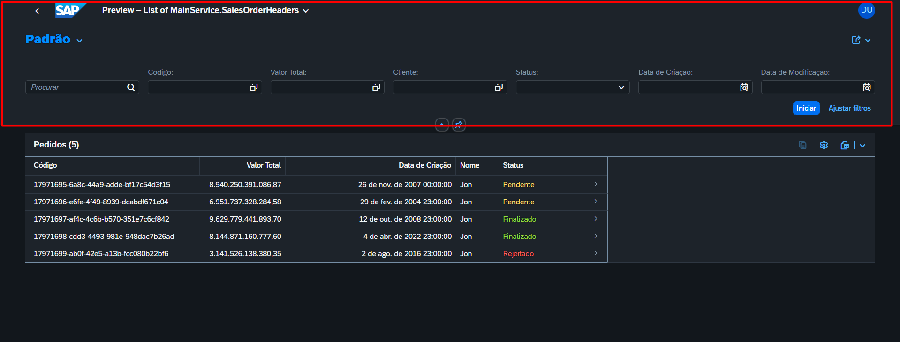
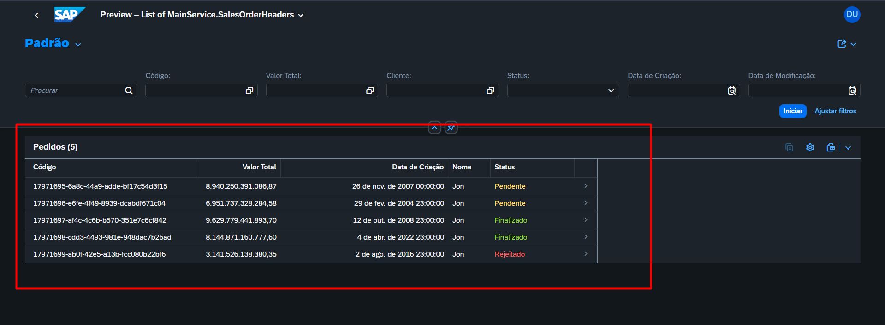
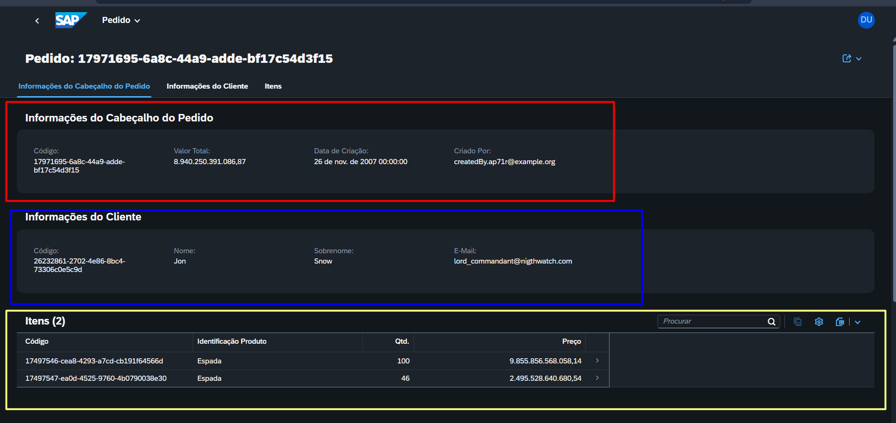
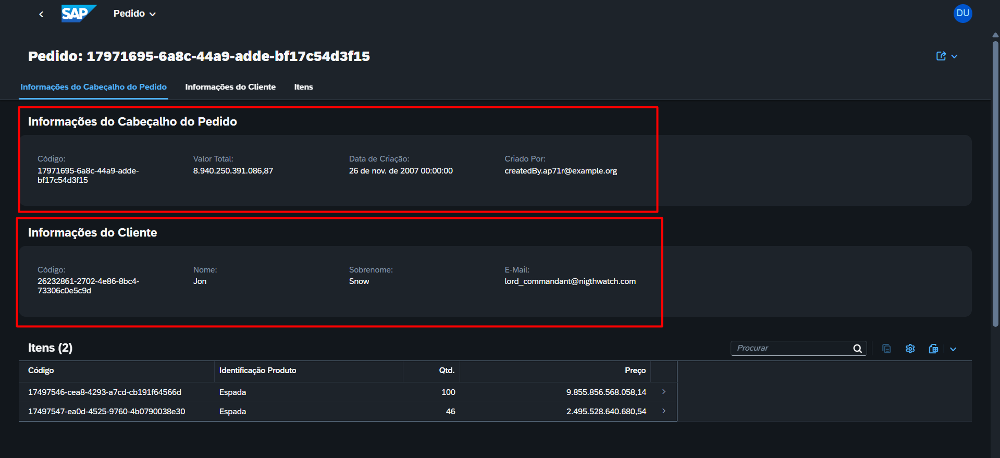
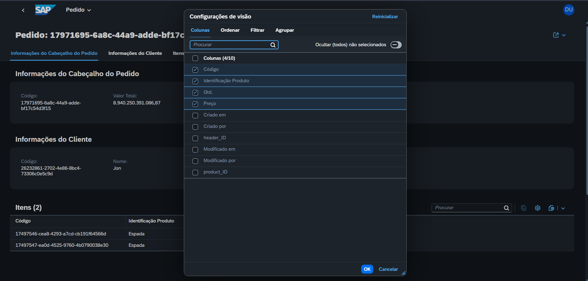
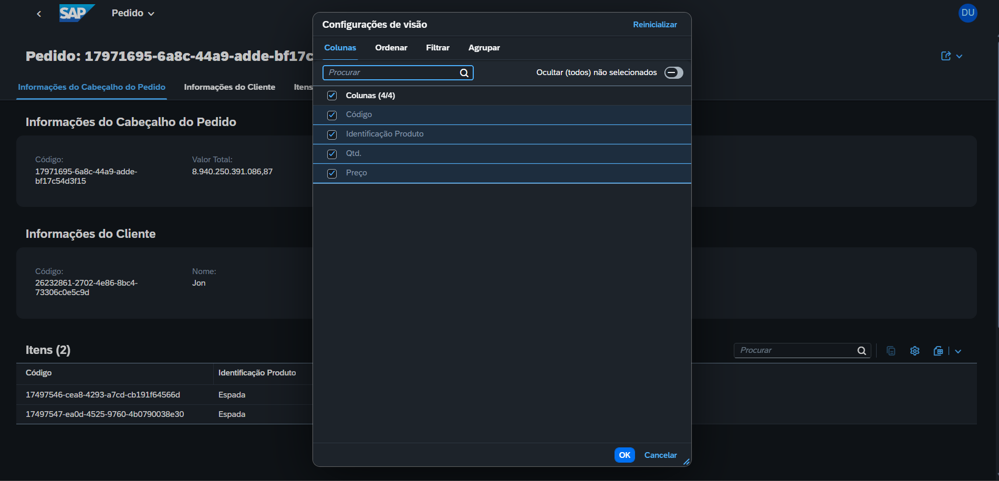

## @UI.SelectionField

Define quais campos são usados em filtros ou buscas

```SAP CAP
annotate ms.SalesOrderHeaders with @(UI: {
        SelectionFields   : [
            ID,
            totalAmount,
            customer_ID,
            status_ID,
            createdAt,
            modifiedAt
        ],
    }
){}
```



## @UI.LineItem

Define os campos a serem exibidos em uma lista ou tabela.

```SAP CAP
annotate ms.SalesOrderHeaders with @(UI: {
        LineItem          : [
            {
                $Type             : 'UI.DataField',
                @HTML5.CssDefaults: {
                    $Type: 'HTML5.CssDefaultsType',
                    width: '20%'
                },
                Label: 'Código'
                Value             : ID
            },
            {
                $Type             : 'UI.DataField',
                @HTML5.CssDefaults: {
                    $Type: 'HTML5.CssDefaultsType',
                    width: '10%'
                },
                Label: 'Valor Total'
                Value             : totalAmount
            },
            {
                $Type             : 'UI.DataField',
                @HTML5.CssDefaults: {
                    $Type: 'HTML5.CssDefaultsType',
                    width: '20%'
                },
                Value             : createdAt
            },
            {
                $Type             : 'UI.DataField',
                @HTML5.CssDefaults: {
                    $Type: 'HTML5.CssDefaultsType',
                    width: '5%',
                },
                Label: 'Nome'
                Value             : customer.firstName
            },
            {
                $Type                    : 'UI.DataField',
                Criticality              : (status.ID = 'REJECTED' ? 1 : (status.ID = 'PENDING' ? 2 : 3)),
                CriticalityRepresentation: #WithoutIcon,
                @HTML5.CssDefaults       : {
                    $Type: 'HTML5.CssDefaultsType',
                    width: '10%',
                },
                Label: 'Valor Total'
                Value                    : status_ID
            }
        ],
    }
) {
	@title: 'Data de Criação'
	@UI.HiddenFilter: false
	createdAt
}
```

- `@title: 'Data de Criação'` retira a necessidade de usar `Label`
- `@UI.HiddenFilter: false` é necessário para que campos do aspect `managed` apareçam na lista



## @UI.facet

Agrupa campos relacionados em seções ou abas

```CDS
annotate ms.SalesOrderHeaders with @(UI: {
       
        // Elemento principal
        Facets            : [
            {
                ID    : 'salesOrderData',
                $Type : 'UI.CollectionFacet',
                Label : 'Informações do Cabeçalho do Pedido',
                Facets: [{
                    ID    : 'header',
                    $Type : 'UI.ReferenceFacet',
                    Target: '@UI.FieldGroup#Header'
                }]
            },
            {
	            // Referencia #Custumers
                ID    : 'customerData',
                $Type : 'UI.ReferenceFacet',
                Label : 'Informações do Cliente',
                Target: 'customer/@UI.FieldGroup#Customers'
            },
            {
	            // #Itens
                ID    : 'itemsData',
                $Type : 'UI.ReferenceFacet',
                Label : 'Itens',
                Target: 'items/@UI.LineItem#Items'
            }
        ],

        // Agrupa informações sobre o cabeçalho do produto
        FieldGroup #Header: {
            $Type: 'UI.FieldGroupType',
            Data : [
                {
                    $Type: 'UI.DataField',
                    Value: ID
                },
                {
                    $Type: 'UI.DataField',
                    Value: totalAmount
                },
                {
                    $Type: 'UI.DataField',
                    Value: createdAt
                },
                {
                    $Type: 'UI.DataField',
                    Value: createdBy
                }
            ]
        },
    }
)
```

```CDS
// Referenciado
annotate ms.Customers with @(UI: {FieldGroup #Customers: {
    $Type: 'UI.FieldGroupType',
    Data : [
        {
            $Type: 'UI.DataField',
            Value: ID
        },
        {
            $Type: 'UI.DataField',
            Value: firstName
        },
        {
            $Type: 'UI.DataField',
            Value: lastName
        },
        {
            $Type: 'UI.DataField',
            Value: email
        },
    ]
}, }) {
    ID        @title: 'Código';
    firstName @title: 'Nome';
    lastName  @title: 'Sobrenome';
    email     @title: 'E-Mail'
}
```

```CDS
// Referenciado
annotate ms.SalesOrderItems with @(UI: {LineItem #Items: [
    {
        $Type             : 'UI.DataField',
        @HTML5.CssDefaults: {
            $Type: 'HTML5.CssDefaultsType',
            width: '20%'
        },
        Value             : ID
    },
    {
        $Type: 'UI.DataField',
        Label: 'Identificação Produto',
        Value: product.name
    },
    {
        $Type: 'UI.DataField',
        Value: quantity
    },
    {
        $Type             : 'UI.DataField',
        @HTML5.CssDefaults: {
            $Type: 'HTML5.CssDefaultsType',
            width: '20%'
        },
        Value             : price
    },
], }) {
    ID         @title: 'Código';
    price      @title: 'Preço';
    quantity   @title: 'Qtd.';
    createdAt  @UI.Hidden;
    createdBy  @UI.Hidden;
    modifiedAt @UI.Hidden;
    modifiedBy @UI.Hidden;
    product    @UI.Hidden;
    header     @UI.Hidden;
};
```



- 🔴 **#Header**
- 🔵 **#Customers**
- 🟡 **#Itens**

## @UI.fieldGroup

Agrupa campos dentro de uma tela de visualização



## @UI.hidden

Oculta campos da interface, mantendo-os no backend

Sem a **annotation**:



Com:



## Criticality

```CDS
{
	$Type: 'UI.DataField',
	Criticality: (status.ID = 'REJECTED' ? 1 : (status.ID = 'PENDING' ? 2 : 3)),
	CriticalityRepresentation: #WithoutIcon,
	@HTML5.CssDefaults: {
		$Type: 'HTML5.CssDefaultsType',
		width: '10%',
	},
	Value: status_ID
}
```

| Valor | Significado                                     |
| ----- | ----------------------------------------------- |
| 0     | <span style="color: #7f7676;">Neutro</span>     |
| 1     | <span style="color: #f51310;">Erro</span>       |
| 2     | <span style="color: #ff6a00;">Atenção</span>    |
| 3     | <span style="color: #14d61e;">Sucesso</span>    |
| 5     | <span style="color: #3b82f5;">informação</span> |
